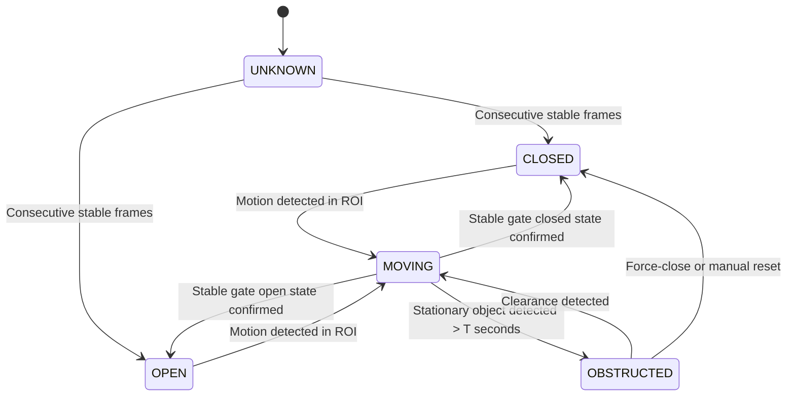
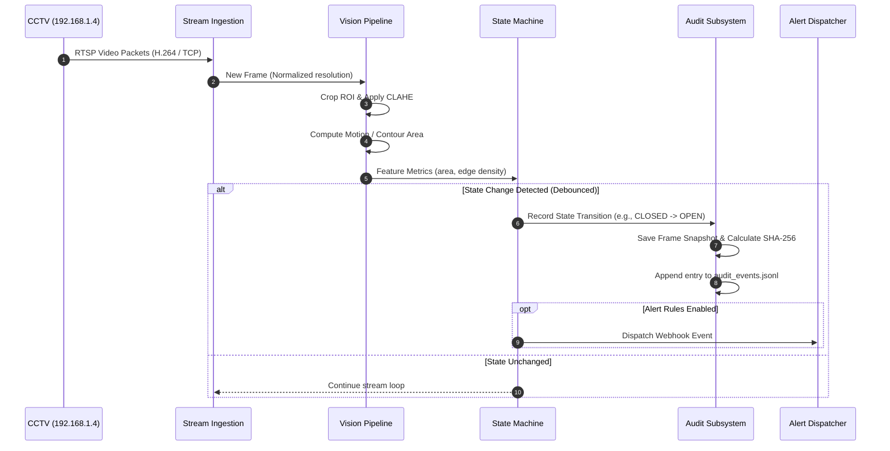

# System Architecture & Technical Design

This document details the architectural blueprints, data flow diagrams, component boundaries, and operational mechanisms of the **Image Processing Gate Checker**.

---

## 1. System Overview

The system is designed as a modular, decoupled pipeline that continuously captures video frames from an RTSP stream (CCTV camera on LAN), pre-processes the image stream, analyzes the Region of Interest (ROI) corresponding to the physical gate, tracks state transitions, and creates immutable audit entries with cryptographic verification and snapshot evidence.

```mermaid
flowchart TD
    subgraph Edge Layer [Edge CCTV Layer]
        CAM["CCTV Camera<br/>IP: 192.168.1.4:554<br/>Format: H.264 / H.265 RTSP"]
    end

    subgraph Ingest Layer [Stream Ingestion Engine]
        RTSP_CLIENT["RTSP Client Receiver<br/>(OpenCV VideoCapture / PyAV)"]
        BUFFER["Frame Ring Buffer<br/>(Drop on Slow Consumer)"]
        HEALTH["Heartbeat & Reconnect Watchdog"]
    end

    subgraph Processing Layer [Vision Processing Pipeline]
        PREPROC["Frame Preprocessor<br/>(Resize, Grayscale, Gaussian Blur, CLAHE)"]
        ROI_EXTRACT["ROI Mask Extractor<br/>(Polygon / Bounding Box)"]
        DETECTOR["Gate Feature Detector<br/>(Background Subtraction / Edge Density)"]
    end

    subgraph State Layer [State Analysis & Logic]
        FSM["Hysteresis State Machine<br/>(CLOSED, OPEN, MOVING, OBSTRUCTED)"]
        CONFIRM["State Debouncer (N frames)"]
    end

    subgraph Persistence Layer [Auditing & Alerts]
        AUDIT["Audit Logger (JSONL)"]
        SNAPSHOT["Snapshot Capture & SHA-256 Hasher"]
        DISPATCHER["Alert Dispatcher (Webhooks / Events)"]
    end

    CAM -->|RTSP Stream (TCP)| RTSP_CLIENT
    RTSP_CLIENT --> BUFFER
    BUFFER --> PREPROC
    HEALTH -.->|Monitor / Reconnect| RTSP_CLIENT
    PREPROC --> ROI_EXTRACT
    ROI_EXTRACT --> DETECTOR
    DETECTOR --> CONFIRM
    CONFIRM --> FSM
    FSM -->|State Transition Event| AUDIT
    FSM -->|State Transition Event| SNAPSHOT
    FSM -->|Alert Rule Matched| DISPATCHER
```

---

## 2. Core Subsystems & Components

### 2.1 RTSP Stream Ingestion Engine
- **Protocol**: RTSP over TCP (`rtsp://192.168.1.4:554/stream1`). TCP transport (`rtsp_transport=tcp`) prevents UDP packet loss and visual artifacting on LAN switches.
- **Resilience**: The watchdog monitors incoming frame intervals. If frames stall for > 3.0 seconds, the client gracefully closes the socket, waits a backoff interval (default 5s), and attempts automatic reconnection.
- **Ring Buffer**: A low-latency ring buffer drops historical frames if downstream processing slows down, ensuring that the detection pipeline always processes real-time frames.

### 2.2 Preprocessing & ROI Masking
1. **Resolution Normalization**: Standardizes frame dimensions (e.g., 1280x720) to maintain uniform feature extraction regardless of camera stream profile changes.
2. **Illumination Correction (CLAHE)**: Contrast Limited Adaptive Histogram Equalization normalizes dynamic lighting changes (direct sunlight, night-vision IR illumination switches, headlight glare).
3. **Region of Interest (ROI)**: Isolates the gate boundaries using a configurable polygon mask, discarding ambient motion (e.g., passing clouds, tree branches, distant traffic).

### 2.3 Gate Detection & Classification
- **Primary Method**: Background Subtraction (`MOG2` or `KNN`) combined with contour edge density analysis across the gate latch/track zone.
- **Secondary Verification**: Frame-difference motion vector estimation across consecutive frames to distinguish active gate transit from stationary obstruction.

### 2.4 Finite State Machine (FSM)
To prevent flickering between states due to momentary video noise or rapid lighting shifts, the state machine implements a hysteresis filter:



States:
- **`CLOSED`**: Gate is fully latched and stationary.
- **`OPEN`**: Gate is wide open or unlatched.
- **`MOVING`**: Active motion identified within the gate trajectory.
- **`OBSTRUCTED`**: An object (vehicle, person, obstacle) has stalled within the gate clearance zone for longer than the configured threshold.
- **`UNKNOWN`**: Initializing or camera connection degraded.

### 2.5 Audit Logging & Evidence Storage
- **Format**: Structured newline-delimited JSON (`.jsonl`).
- **Fields**: Universal timestamp (UTC ISO 8601), local timestamp, event ID (UUIDv4), camera identifier, previous state, new state, confidence score, frame cryptographic hash (SHA-256), and path to visual snapshot.
- **Integrity**: Every state change triggers a saved snapshot with its SHA-256 recorded in the audit log for chain-of-custody verification.

---

## 3. End-to-End Execution Sequence



---

## 4. Failure Modes & Resilience Strategies

| Failure Mode | Impact | Mitigation Strategy |
| :--- | :--- | :--- |
| **Camera Disconnection** | RTSP stream drops or returns empty frames | Watchdog detects frame timeout; fires `CAMERA_DISCONNECTED` audit event; retries connection with backoff. |
| **Network Congestion** | Frame lag / packet drops | RTSP transport locked to TCP; ring buffer drops stale frames to avoid queue accumulation. |
| **Severe Lighting Shift (Sun/IR)** | False motion detection | CLAHE normalization; debouncing requires $N$ consecutive stable frames before triggering state transition. |
| **Tampering / Lens Occlusion** | Zero variance in pixel values | Low entropy detector detects blind camera condition and generates a high-priority alert. |
| **Storage Full** | Cannot record audit snapshots | Configurable retention manager purges snapshots older than $X$ days, reserving disk capacity for structured JSONL logs. |

---

## 5. Security & Isolation

1. **Credential Sanitization**: Passwords never appear in clear text in logs, stdout, or error stack traces.
2. **Network Perimeter**: Designed to operate within an isolated CCTV VLAN or LAN subnet without external internet dependencies.
3. **Audit Immutability**: Append-only log design preventing historical tampering.
